<p align="center">
  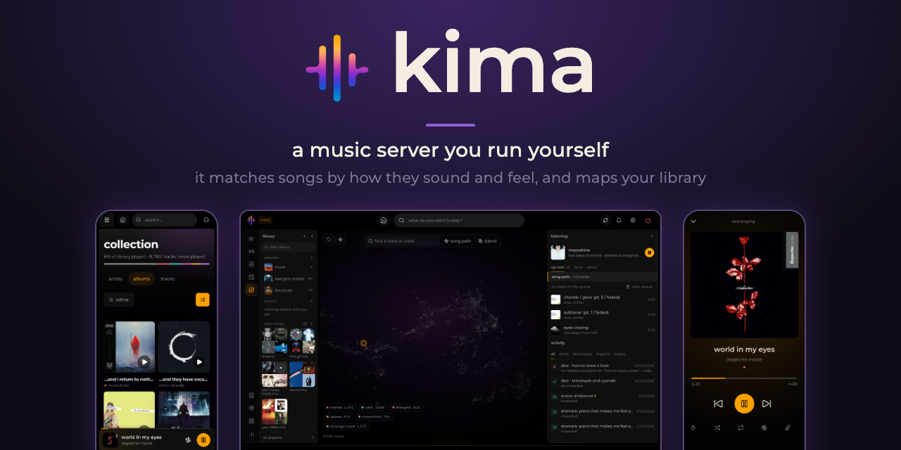
</p>

<p align="center">
  <a href="https://hub.docker.com/r/chevron7locked/kima"></a>
  <a href="https://github.com/Chevron7Locked/kima-hub/releases"></a>
  <a href="https://www.gnu.org/licenses/gpl-3.0"></a>
  <a href="https://kima-hub.dev"></a>
</p>

Kima is a music server you run yourself. Point it at a folder of music and it gives you a web app to play it from, on a computer or a phone, along with podcasts and audiobooks. It also works out how each song sounds and feels, so it can find songs that match and lay your whole library out as a map.

**Web app:** any modern browser, and it installs to your home screen as an app.
**iOS app:** coming soon to the App Store.

> [!CAUTION]
> ### Upgrading from 1.11 to 1.12 redoes your library's enrichment
> 1.12 replaces the sound model with a music-tuned one that runs on ONNX Runtime, and adds moods from scorers trained on that model. So the update deletes your library's old sound vectors, then analyses every song again and works out its sound vector and moods in the background. Search by sound fills in as songs are done; similar tracks, the vibe map and the mood stations come back once every song has its new sound vector. Your music, playlists, plays, likes, edits, identification and artists stay. It took just under two hours for 9,176 songs with a GPU, and takes longer without one. See the [1.12 release notes](https://github.com/Chevron7Locked/kima-hub/releases).

<p align="center">
  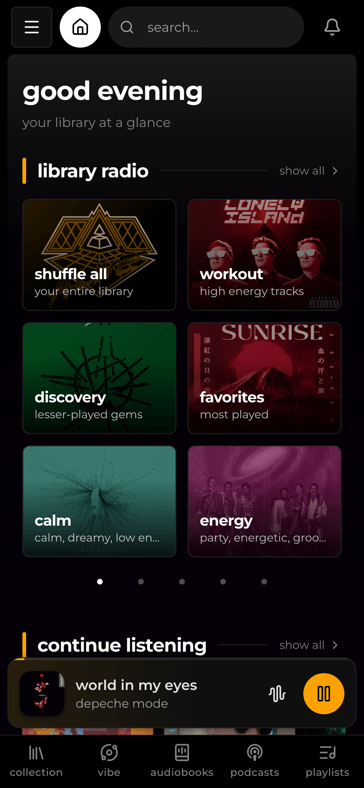
  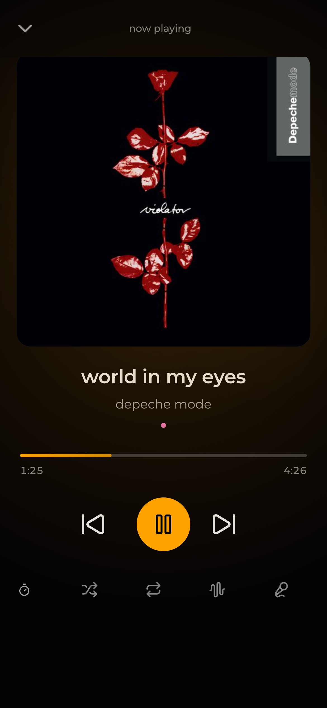
  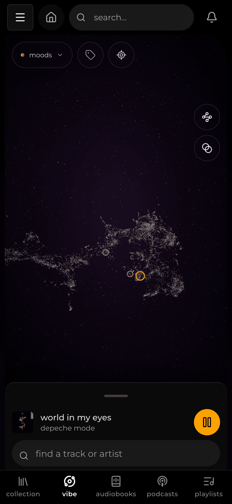
  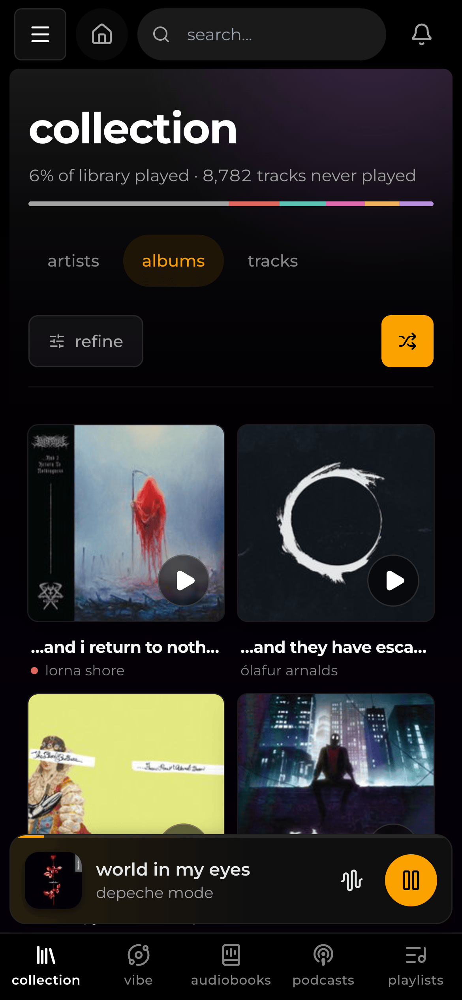
</p>

## The vibe engine

Kima compares songs on three things: how they sound, how they feel and their artists' genres.

| | What it is | Weight |
| --- | --- | --- |
| **Sound** | A list of numbers that an audio model (CLAP, from LAION) produces by listening to the song. Songs that sound alike get similar lists. | 1 |
| **Feel** | How the song feels: calm or intense, bright or dark (its valence and arousal). It is read from the audio and measured against the rest of your library, so a song counts as calm compared with your other music. | 0.25 |
| **Genre** | The genres MusicBrainz lists for the song's artist. They count only between songs by different artists, so one artist's songs do not match each other just because they share genres. | 0.25 |

The three are combined into one similarity score, which every vibe feature uses: similar tracks, recommendations from a track, Song Path, Blend and the ranking of similar artists. A list holds at most 2 songs from one album and 4 from one artist. Searching with words matches on sound only, because a sentence has no feel or genre. Library radio stations are separate and do not use the score. The moods Kima scores for each song are not part of it either. They label songs for mood mixes and stations and for the map's mood buttons.

### The map

Open **Vibe** in the sidebar. Your library appears as a 3D picture laid out from that same score, so songs that match sit close together. The map is laid out once, after your library has been through enrichment. New songs are placed among the others and keep their place. Wiping and re-running enrichment lays out a new map.

<p align="center">
  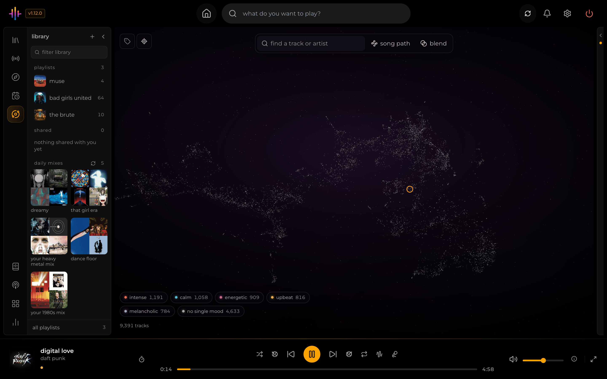
</p>

Click a star to see the song with four actions: Play, Match Vibe (queue the song and its closest matches), Similar (light up its closest matches on the map) and Song Path. The search box finds songs and artists by name. Song Path and Blend can also start from a description of the sound, such as "quiet piano".

<p align="center">
  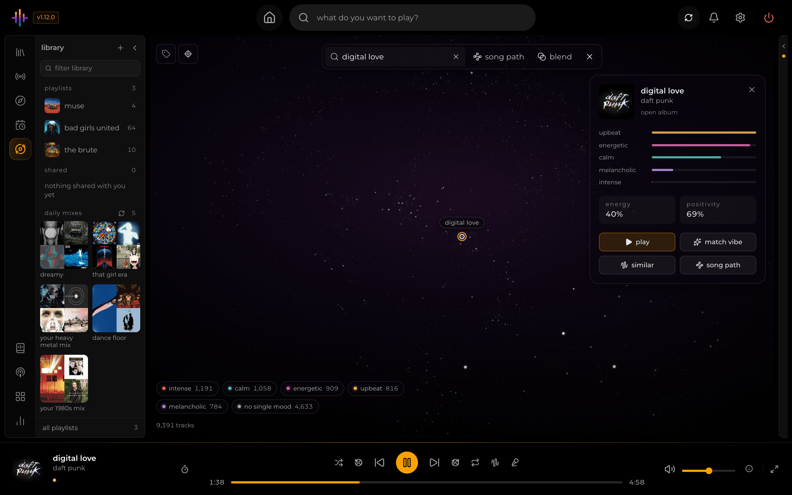
  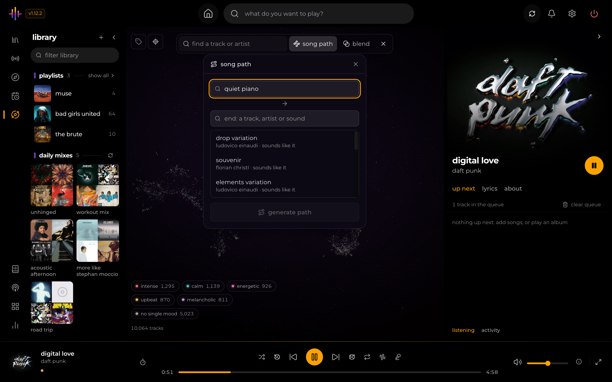
</p>

### Song Path and Blend

**Song Path** takes a start and an end, either a song, an artist or a sound, and queues a run of songs that moves from one to the other.

**Blend** takes songs you want more of and, if you like, songs you want less of, and builds a playlist from the songs that match the first group and not the second.

<p align="center">
  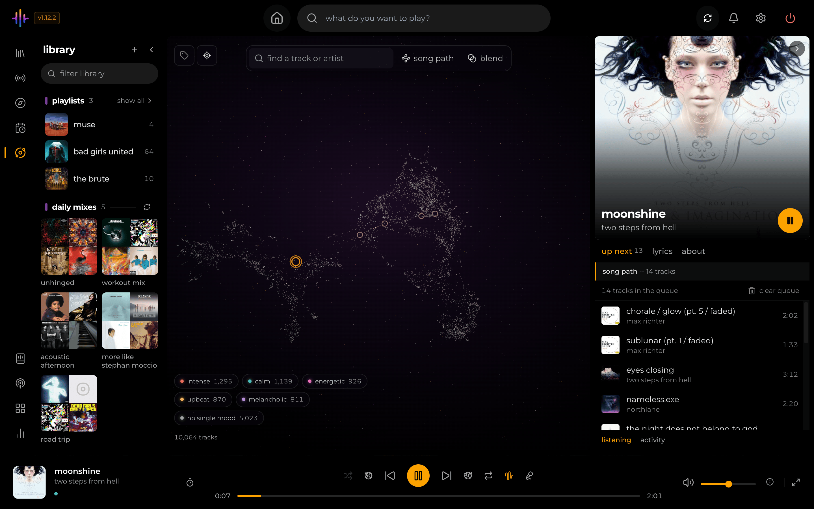
  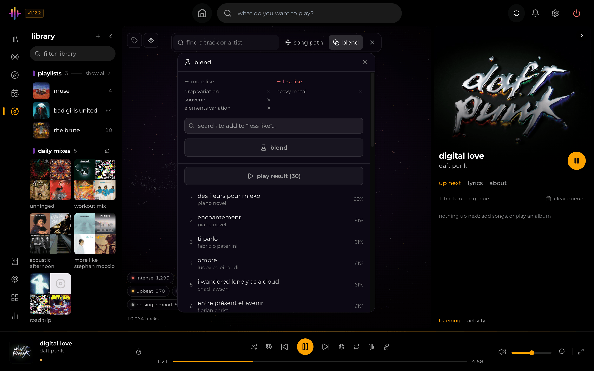
</p>

### How songs are analysed

After a scan has finished, Kima runs six enrichment steps in the background: song identification, artist metadata, audio analysis, vibe embeddings (the sound vectors), moods and similarity (the matches and the map). Identification, artist metadata and audio analysis run side by side; the sound vectors come after audio analysis has finished every song, then the moods, then similarity. **Settings > Library Enrichment** shows their progress. On a 16-core machine running 16 workers, 1.11 took 87 minutes for 9,004 songs with an NVIDIA RTX 4060 Ti and both GPU switches on, and 98 minutes for 8,985 songs without a graphics card. 1.12 adds the moods step and a heavier sound model. On the same machine with the GPU, upgrading a 9,176-song library took 1 hour 55 minutes. The upgrade redoes every step except identification and artist metadata. A first enrichment on 1.12 has not been timed yet. Fewer cores or workers take longer. Audio analysis reads the middle 90 seconds of each song, or the whole song when it is shorter. The sound vector comes from five 10-second samples spread across the song. The two audio models never run at the same time: each finishes every song it owes before the other starts, and a song added in the meantime waits its turn. Both run on ONNX Runtime on the processor, and an optional switch moves them to an NVIDIA graphics card (see [docs/gpu.md](docs/gpu.md)).

## Features

<p align="center">
  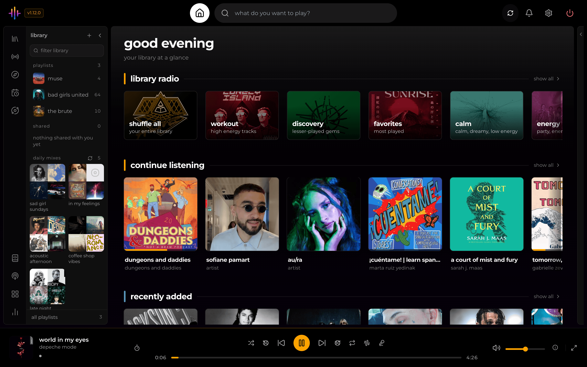
</p>

After each update, Kima shows a short list of what changed, sometimes with a note from Kevin. Each item opens a page with more detail and any buttons or links it needs.

### Your library

- **Your files.** Reads MP3, FLAC, M4A, AAC, OGG, Opus, WAV, WMA, APE and WV files, and identifies them with MusicBrainz: first by a MusicBrainz tag in the file, then by an AcoustID audio fingerprint, then by the album's track list, the recording's standard code (ISRC) and a search by name that checks the title.
- **Streaming quality.** Play the original file, or have Kima convert it on the fly to 320, 192 or 128 kbps.
- **Lyrics.** Shows lyrics stored in the file, or fetches them from LRCLIB. Timed lyrics follow along with the song.
- **Playlists.** Make them private or public to the other accounts on your server, drag to reorder, or share one as a link that opens without an account.
- **Stats.** A page on what you replay most, which artists make up most of your listening and how much of your library you have never played.

<p align="center">
  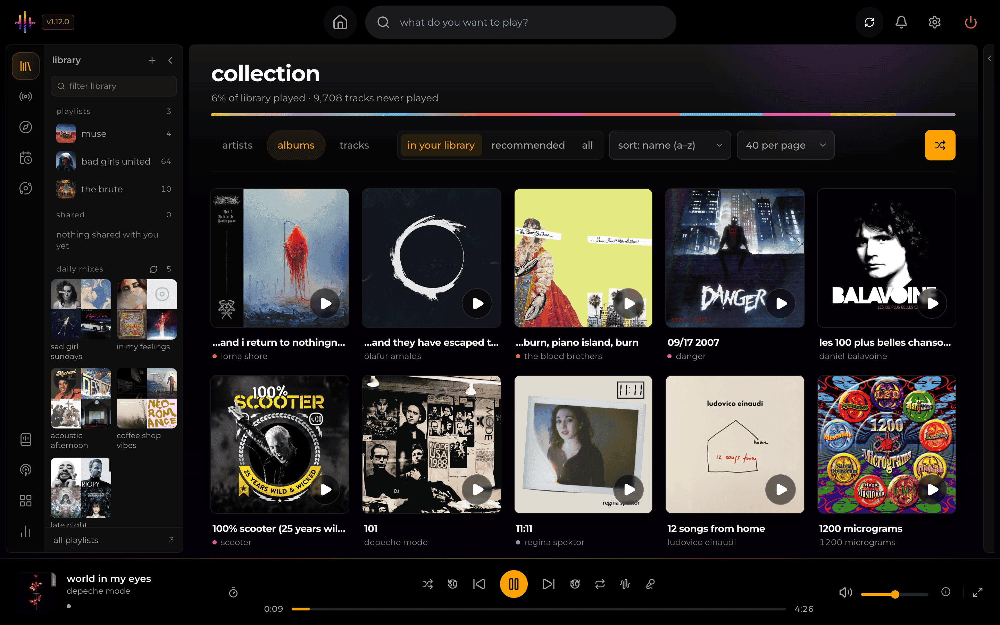
  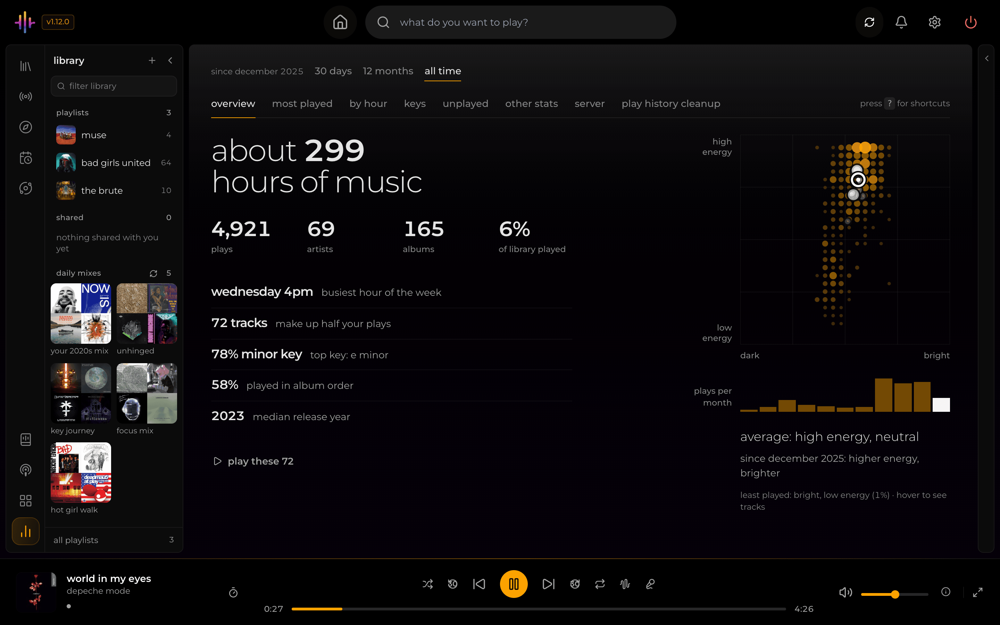
</p>

<p align="center">
  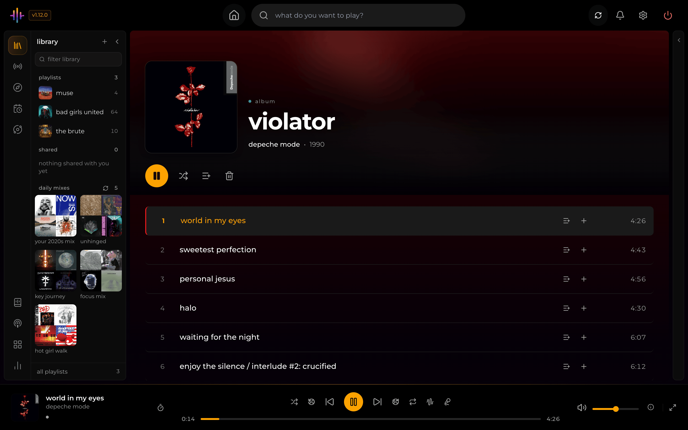
  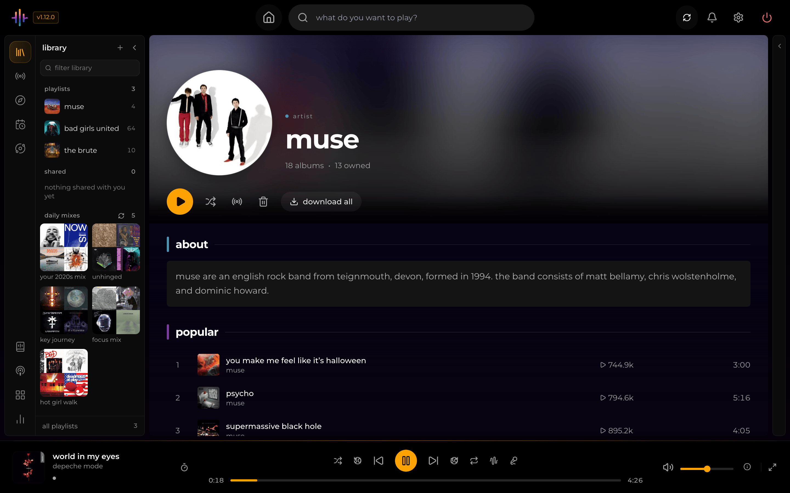
</p>


### Finding something to play

- **Mood mixes.** Pick one of five moods and Kima builds a playlist from the songs that fit.
- **Made for you and radio.** Generated mixes on the home page, and one-click radio stations: shuffle everything, high energy, lesser-played, most played, stations for your common genres and decades, and 14 mood stations (Calm, Road Trip, Wildcard, Late Night and more). Late Night plays from your own late-night listening. The others are built from the moods Kima scores for each song.
- **Similar artists.** Taken from ListenBrainz, with Deezer as a fallback, and ranked toward your library. Each one shows how many of their albums you own.
- **Weekly discovery.** Weekly playlists of music you do not own, built from similar artists and downloaded through Lidarr or Soulseek. Those songs play only in Discover until you like one, which moves its whole album into your library.

<p align="center">
  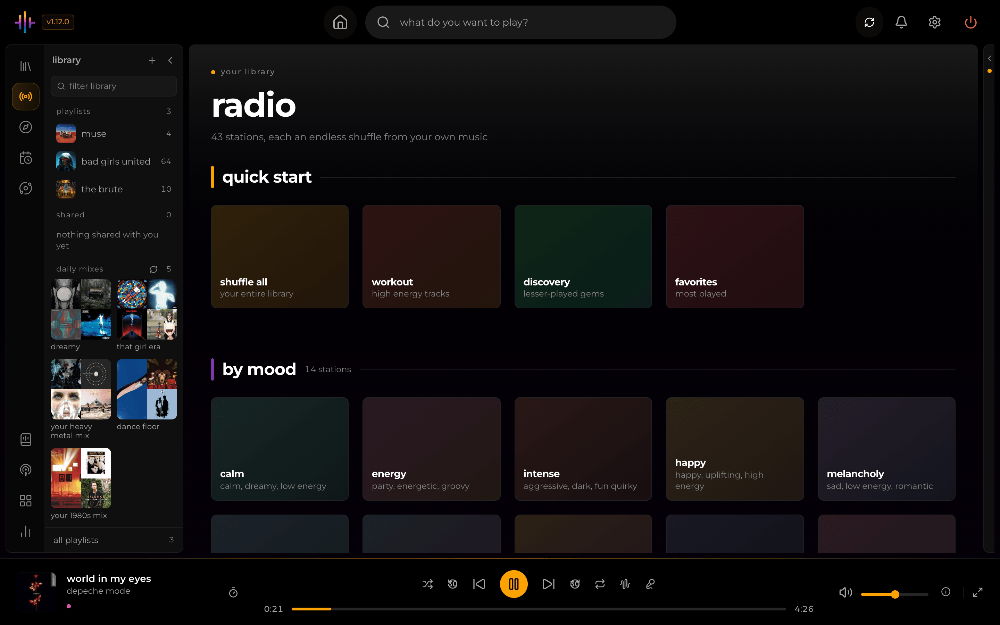
  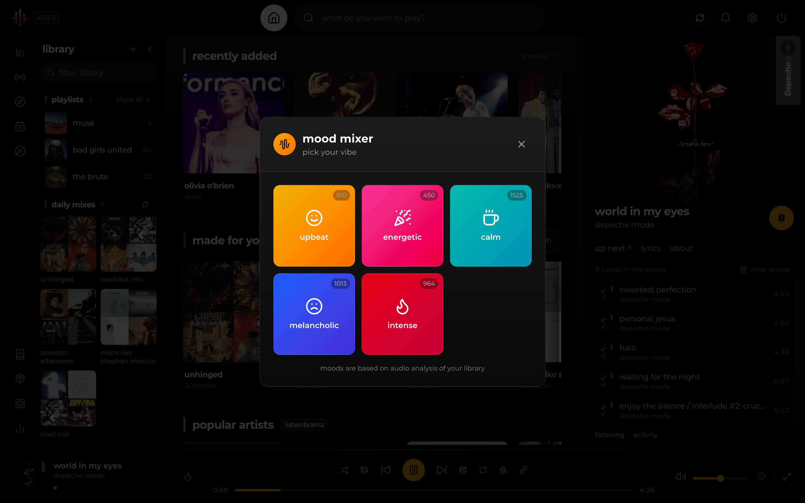
</p>

### Podcasts and audiobooks

- **Podcasts.** Browse Apple Podcasts' charts and categories (the chart country is a setting), search for a show, play its first episode before you follow it, and subscribe. Kima streams episodes from the show's own feed and remembers your place across devices.
- **Audiobooks.** Connect an [Audiobookshelf](https://www.audiobookshelf.org/) server and listen alongside your music. Your position is saved back to it.

<p align="center">
  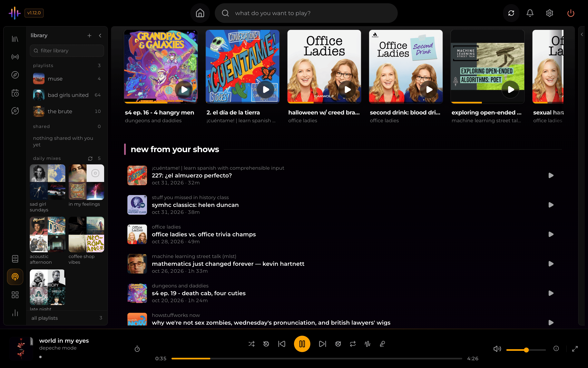
  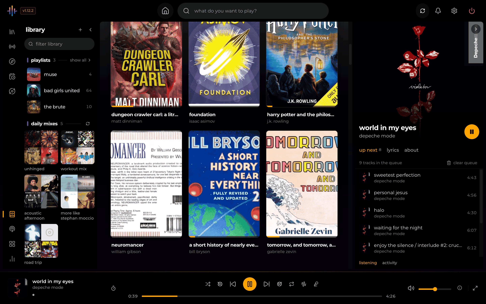
</p>

### Getting music

- **Lidarr.** Request an album you do not own, and Kima adds it when Lidarr finishes the download.
- **Soulseek.** Search the network and download from it, through Kima's own connection or your [slskd](https://github.com/slskd/slskd) server.
- **Playlist import.** Bring in playlists from Spotify, Deezer, YouTube, YouTube Music, SoundCloud, Bandcamp and Mixcloud, or an M3U file. Kima matches each track to your library and can send the missing ones to your download source.

### Accounts and apps

- **Several users.** Each account has its own plays, playlists and settings. The first account is the administrator, and any account can turn on two-factor authentication.
- **Other apps.** Kima supports the OpenSubsonic API, so Subsonic music apps can play from it. Each app gets its own token, which you can revoke.
- **Scrobbling.** Optionally send your plays to your own ListenBrainz account.
- **TV.** Kima switches to a layout for remote controls on Android TV, Fire TV and Google TV browsers.

## Requirements

- Docker, on a `linux/amd64` or `linux/arm64` machine.
- A folder of music.
- Memory: each audio analysis worker needs about 1 to 1.5 GB, and up to 2 to 3 GB at its peak. `docker-compose.server.yml` and `docker-compose.prod.yml` limit the container to 6 GB. On a small machine, lower the worker count in **Settings > Library Enrichment**.
- A modern web browser.
- Optional: an NVIDIA graphics card (see [docs/gpu.md](docs/gpu.md)), and Lidarr, Audiobookshelf or slskd if you use those features.

## Quick start

```bash
docker run -d \
  --name kima \
  -p 3030:3030 \
  -v /path/to/your/music:/music \
  -v kima_data:/data \
  chevron7locked/kima:latest
```

Open <http://localhost:3030> and create your account. The first account becomes the administrator. When setup finishes, Kima scans your music and starts enrichment.

The same thing as a Compose file:

```yaml
services:
    kima:
        image: chevron7locked/kima:latest
        container_name: kima
        ports:
            - "3030:3030"
        volumes:
            - /path/to/your/music:/music
            - kima_data:/data
        extra_hosts:
            - "host.docker.internal:host-gateway"
        restart: unless-stopped

volumes:
    kima_data:
```

`/data` holds the database, the caches and the secrets Kima generates on its first start. Back it up: without it you lose your users, playlists and play history, and the credentials you saved in Settings can no longer be read.

To update, run `docker compose pull` and then `docker compose up -d`. [docs/install.md](docs/install.md) covers the other Compose files, bind-mounting `/data`, pre-release images and installing Kima on a phone.

## Configuration

Most things are set in the web app, under **Settings**. In the all-in-one image the two secrets, `SESSION_SECRET` and `SETTINGS_ENCRYPTION_KEY`, are created for you. These environment variables are the ones you are most likely to want:

| Variable | What it does |
| --- | --- |
| `SECURE_COOKIES` | Set to `true` when Kima is served over HTTPS. |
| `ALLOWED_ORIGINS` | Comma-separated origins allowed to call the API from a browser. Unset allows any. |
| `KIMA_CALLBACK_URL` | The address Lidarr uses to reach Kima. |
| `LOG_LEVEL` | `debug`, `info`, `warn`, `error` or `silent`. |
| `TZ` | Your time zone, such as `America/Chicago`. The daily mixes and Discover Weekly roll over at midnight here. Unset means UTC. |
| `DISABLE_CLAP` | Set to `true` to stop the sound-vector analyzer. The vibe features then do not work. |

Every variable, the ports and the storage paths are in [docs/configuration.md](docs/configuration.md).

## Documentation

| Guide | What it covers |
| --- | --- |
| [Install and update](docs/install.md) | Every Compose file, updating, stable and pre-release images, phones and TVs |
| [Using Kima](docs/using-kima.md) | A tour of the web app and its keyboard shortcuts |
| [Configuration](docs/configuration.md) | Settings, environment variables, ports and storage paths |
| [Administration](docs/administration.md) | Enrichment, users, job queues, backups and logs |
| [Integrations](docs/integrations.md) | Lidarr, Soulseek, Audiobookshelf, ListenBrainz and playlist import |
| [Subsonic clients](docs/subsonic.md) | Connecting other music apps |
| [NVIDIA GPU](docs/gpu.md) | Moving the audio models onto a graphics card |
| [Security](docs/security.md) | Secrets, sign-in, and opening Kima to the internet |
| [Development](docs/development.md) | Running from source, tests and releases |
| [Privacy](PRIVACY.md) | What Kima sends to outside services |
| [Changelog](CHANGELOG.md) | What changed in each version |

Kima has no telemetry or analytics, and the author receives nothing from your install. [PRIVACY.md](PRIVACY.md) lists each outside service your server contacts and what it sends.

## Contributing

Bug reports and questions go to [GitHub Issues](https://github.com/Chevron7Locked/kima-hub/issues). Include your Kima version and the output of `docker logs kima`. To change the code, read [CONTRIBUTING.md](CONTRIBUTING.md), then [docs/development.md](docs/development.md) for running Kima from source and the checks a pull request must pass.

## Licence

Kima is released under the [GNU General Public License v3.0](LICENSE).

The feel weights in `backend/src/services/matching/feelProbe.json` are derived from the DEAM dataset (Aljanaki, Yang & Soleymani, PLOS ONE 2017), which its authors release under Creative Commons BY-NC. That file is licensed under those terms and credited to DEAM. The rest of Kima is under the GPL.

## Acknowledgements

Kima builds on these projects and services:

- [MusicBrainz](https://musicbrainz.org/), [Cover Art Archive](https://coverartarchive.org/) and [Wikidata](https://www.wikidata.org/) for metadata, artwork and artist biographies
- [ListenBrainz](https://listenbrainz.org/) for similar artists, charts and open scrobbling
- [AcoustID](https://acoustid.org/) for audio-fingerprint identification
- [Deezer](https://developers.deezer.com/) for similar artists, artwork and playlist browsing, and [Fanart.tv](https://fanart.tv/) for artist images
- [LRCLIB](https://lrclib.net/) for lyrics
- [Apple's iTunes Search API](https://developer.apple.com/library/archive/documentation/AudioVideo/Conceptual/iTuneSearchAPI/) and Apple Podcasts' charts for podcast search and discovery
- [Odesli](https://odesli.co/) (song.link) for resolving links from other music services during playlist import, and [yt-dlp](https://github.com/yt-dlp/yt-dlp) for reading playlist links
- [LAION-CLAP](https://github.com/LAION-AI/CLAP)'s music checkpoint ([lukewys/laion_clap](https://huggingface.co/lukewys/laion_clap), CC0-1.0) for the sound model, and [Essentia](https://essentia.upf.edu/) with its MusiCNN models for audio analysis
- [DEAM](https://cvml.unige.ch/databases/DEAM/) for the human valence and arousal ratings behind the feel part of matching
- [UMAP](https://arxiv.org/abs/1802.03426) (McInnes, Healy and Melville) for the method behind the map's layout
- [Lidarr](https://lidarr.audio/), [Audiobookshelf](https://www.audiobookshelf.org/) and [slskd](https://github.com/slskd/slskd) for the services Kima connects to
